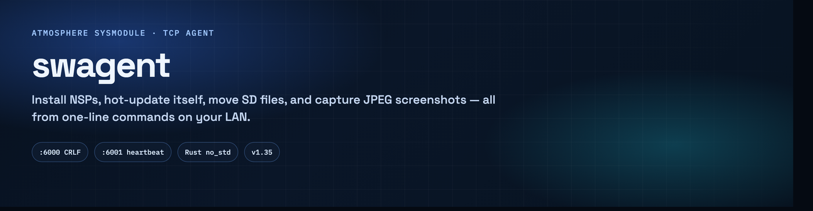
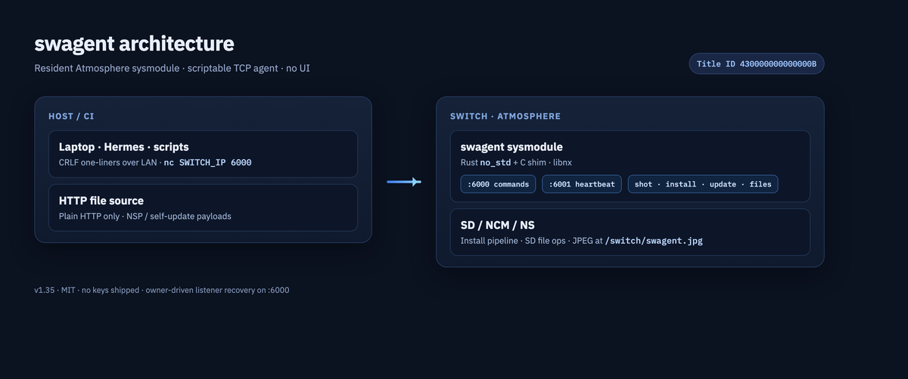
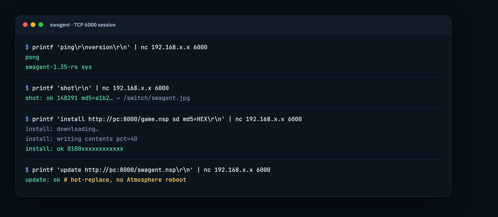

# swagent

[English](README.md) | [简体中文](README.zh-CN.md)

<p align="center">
  
</p>

Headless Atmosphere **sysmodule** that turns a Nintendo Switch into a small TCP command agent: install NSPs, hot-update itself, move files on the SD card, capture a JPEG screenshot, and report status — no on-console UI.

- **Title ID:** `430000000000000B`
- **Ports:** `6000` (commands, CRLF) · `6001` (heartbeat `pong`)
- **Stack:** Rust `no_std` staticlib + tiny C ABI shim, linked with stock libnx/devkitA64
- **Current build string:** `swagent-1.35-rs`

> **Disclaimer** — For consoles you own and content you are entitled to use. Ships with no keys, firmware, or proprietary Nintendo code. Not affiliated with Nintendo. Use at your own risk.

## Why this exists

Most Switch remotes are either full FTP daemons, game-input proxies, or GUI installers. swagent is the opposite: a **resident, scriptable pipe** you talk to from a laptop/CI agent with one-line commands. Install stays off the receive thread; `ping` / `version` / `update` stay fast; recovery of the listener is owner-driven so a stuck accept does not require guessing which FD to kill.



## Install

### Requirements

- Atmosphère on the Switch
- On the build machine: `$DEVKITPRO` (default `$HOME/devkitpro`), libnx, rustup stable with `aarch64-unknown-none`

### From a release (recommended)

1. Download `swagent.nsp` from the [latest release](https://github.com/yorha59/swagent/releases/latest).
2. Place it at:

```text
atmosphere/contents/430000000000000B/exefs.nsp
atmosphere/contents/430000000000000B/flags/boot2.flag   # empty file
```

3. Cold-start into Atmosphère once. Later upgrades can use the live `update` command (no full power-cycle).

### From source

```sh
rustup target add aarch64-unknown-none
make -j2
make check          # host tests + artifact checks
# optional: make release-check
cp -R dist/atmosphere /path/to/sd_root/
```

Optional hbmenu edition: `make nro` → copy `dist/switch/swagent.nro` to `/switch/`.

## Quick start

Every command and reply ends with `\r\n`. One active client on port 6000.

```sh
printf 'ping\r\nversion\r\n' | nc SWITCH_IP 6000
# optional liveness lane (any byte → pong)
printf 'x' | nc SWITCH_IP 6001
```

Install an NSP over plain HTTP (HTTPS not supported):

```sh
printf 'install http://PC:8000/game.nsp sd md5=HEXDIGEST\r\n' | nc SWITCH_IP 6000
```

Hot-replace the sysmodule itself:

```sh
printf 'update http://PC:8000/swagent.nsp\r\n' | nc SWITCH_IP 6000
```

Screenshot → fetch JPEG:

```sh
printf 'shot\r\n' | nc SWITCH_IP 6000
# then: cat /switch/swagent.jpg  (binary framed; see Protocol)
```

## Protocol (summary)



| Command | Purpose |
| --- | --- |
| `ping` | `pong` |
| `version` | `swagent-1.35-rs sys` or `... nro` |
| `status` | short listener/health line |
| `log [N]` | ring (+ file tail when available), then `log: end` |
| `install URL [sd\|nand] [md5=HEX]` | Goldleaf-style NSP install via HTTP |
| `update URL` | download + swap `exefs.nsp`, relaunch self |
| `shot` | JPEG to `/switch/swagent.jpg` |
| `hash PATH` | `hash: md5 HEX` |
| `cat` / `put` / `ls` / `mkdir` / `rm` / `tail` | SD file ops (`put` ≤ 4 MiB, `cat` ≤ 512 KiB) |
| `ps` / `kill PID` / `launch TITLEID` / `quit TITLEID` | process helpers (`launch` needs `[am.debug] dev_function`) |
| `installed` / `installed del …` | list / delete application records |
| `dump …` | export installed title as NSP |
| `set …` / `sleep on\|off` / `wifi …` | readouts and a few console settings |
| `reboot` | request full console power-cycle via bpc |

Malformed lines are discarded through the next CRLF; the stream recovers. Queue overflow returns exactly `error: busy`. Details and limits: [CHANGELOG.md](CHANGELOG.md), [RESEARCH.md](RESEARCH.md), [LAUNCH_RESEARCH.md](LAUNCH_RESEARCH.md).

`launch` requires in `sd:/atmosphere/config/system_settings.ini`:

```ini
[am.debug]
dev_function = u8!0x1
```

## Design notes

- Fixed 16 MiB heap; install reuses one 4 MiB buffer — allocation does not scale with NSP size.
- No SD log files on the critical path for command replies; persistent log is best-effort with 1 MiB rotation under `/switch/swagent.log`.
- Port 6000 has a single socket owner; the watchdog only requests rebuilds. Port 6001 is an independent heartbeat lane.
- Plain HTTP only (200/206). No redirects, no TLS, no compressed bodies.

## Comparison (honest)

| | swagent | sys-ftpd | DBI / Tinfoil | sys-botbase-class |
| --- | --- | --- | --- | --- |
| Form | headless sysmodule | FTP sysmodule | on-console UI installer | input / automation |
| Scriptable one-liners | yes (CRLF TCP) | via FTP client | limited | yes, different domain |
| Self hot-update | `update` | no | n/a | rare |
| NSP install from PC HTTP | yes | no | local/USB/net own stack | no |
| Screenshot | `shot` JPEG | no | n/a | varies |

## Safety / privacy

- This repository **does not** ship `prod.keys` or console dumps. Provide your own keys on-device the usual Atmosphère way if a feature needs them.
- Do not commit LAN helper scripts, absolute home paths, or credentials. `.gitignore` already blocks `*.keys` and local NAS helpers.

## License

[MIT](LICENSE) © yorha59
